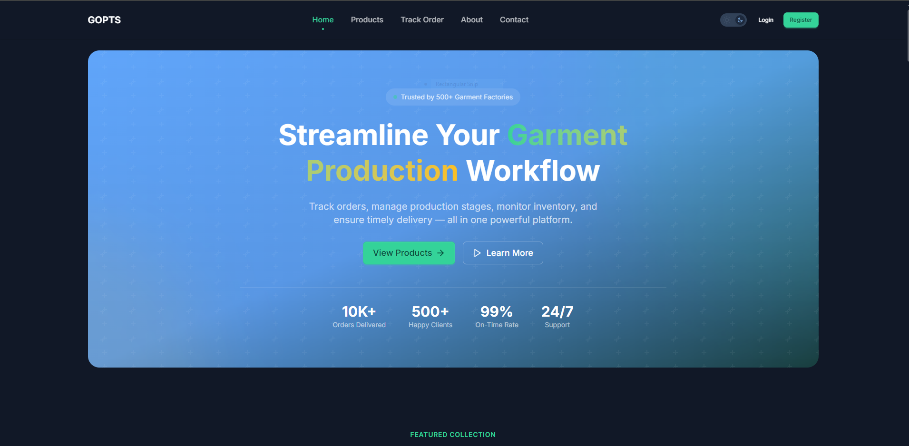
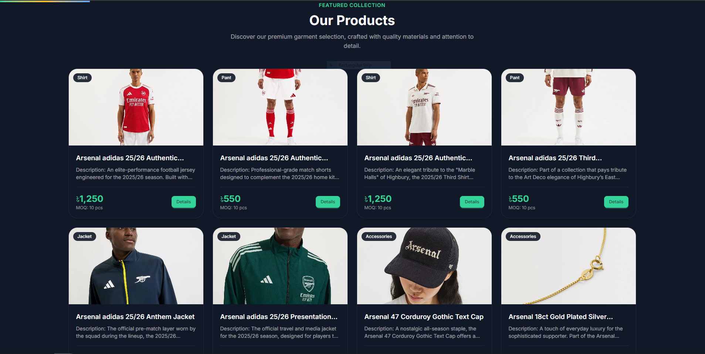
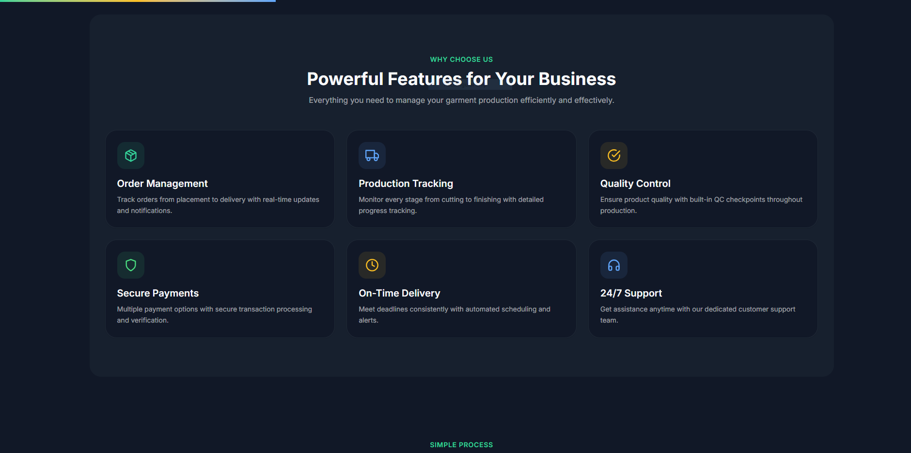
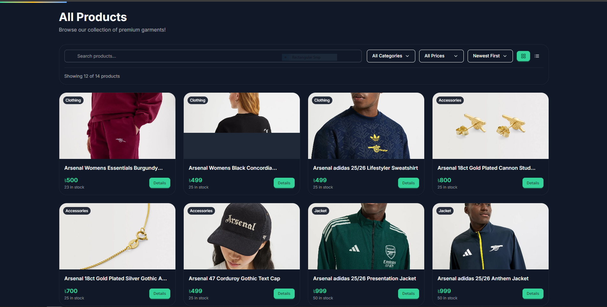
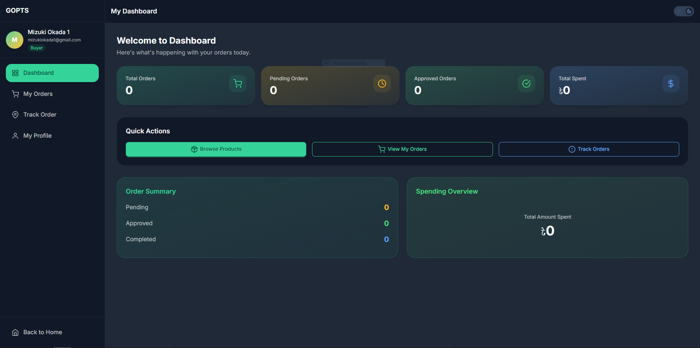
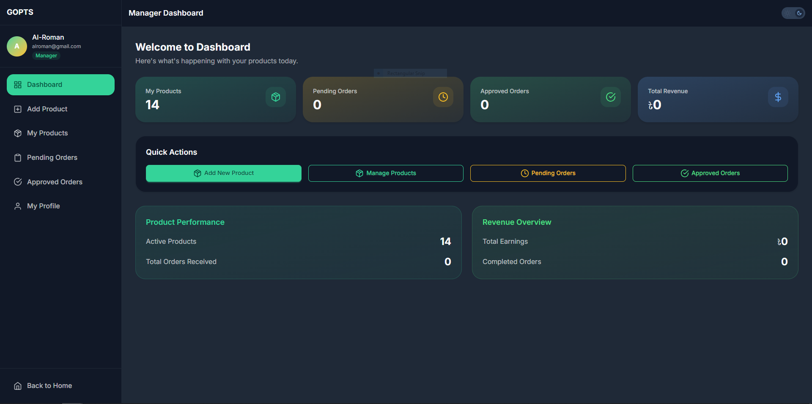
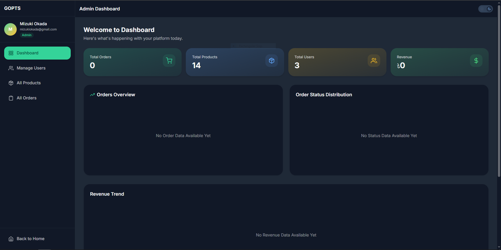

# 👕 Garments Order & Production Tracker System (Client)



## 📌 Project Overview

The **Garments Order & Production Tracker System (GOPTS)** is a comprehensive full-stack solution designed to digitize and streamline the complex operations of garment manufacturing. From order placement to detailed production tracking and final delivery, this platform ensures transparency and efficiency for all stakeholders including Admins, Managers, and Buyers.

This client-side application provides a modern, responsive interface for managing the entire production lifecycle with role-specific dashboards and real-time updates.

🌐 **Live Application:** [https://mygopts.web.app/](https://mygopts.web.app/)

---

## 📸 App Glimpses

<div align="center">
  
  
  
  
  
  
  
</div>

---

## 🎯 Key Features

### 🔐 Authentication & Security
- **Secure Access:** Email/Password authentication powered by Firebase.
- **Social Integration:** One-click login via Google and GitHub.
- **Role-Based Access Control (RBAC):** Distinct access levels for **Admin**, **Manager**, and **Buyer** to ensure data security.
- **JWT Authorization:** Secure, token-based API communication.

### 🏭 Production & Order Management
- **Smart Ordering:** Role-based booking system with MOQ validation and stock checks.
- **Workflow Tracking:** Detailed production timeline tracking (Cutting -> Sewing -> QC -> Finishing -> Packing).
- **Product Management:** Comprehensive catalog with search, filtering, and detailed product views.

### 📊 Role-Based Dashboards
- **👑 Admin:** Complete oversight of users, products, orders, and system analytics.
- **🧑‍💼 Manager:** Tools for product creation, order approval, and updating production stages.
- **🧑 Buyer:** Personalized dashboard to track orders, view status updates, and manage profile.

### 🎨 User Experience
- **Responsive Design:** Optimized for seamless use on Mobile, Tablet, and Desktop.
- **Theme Support:** Built-in Dark and Light mode toggle.
- **Interactive UI:** Smooth animations with Framer Motion, engaging carousels, and intuitive navigation.

---

## 🛠 Tech Stack

### Frontend Core
- **React 19:** Component-based UI architecture.
- **Vite:** High-performance frontend tooling.
- **React Router 7:** Dynamic client-side routing.

### State Management & Data Fetching
- **TanStack Query (React Query):** Robust server-state management and caching.
- **Axios:** Efficient HTTP client for API interactions.
- **React Context API:** Global state management for authentication.

### Styling & UI Components
- **Tailwind CSS 4:** Utility-first framework for rapid, custom design.
- **DaisyUI 5:** Component library for accessible UI elements.
- **Framer Motion:** Production-grade animation library.
- **React Hook Form:** Performance-focused form validation.

### Services & Integrations
- **Firebase Authentication:** Secure identity platform.
- **EmailJS:** Integrated email service for notifications.
- **SweetAlert2 / Toast:** User-friendly feedback and notifications.

---

## 🚀 Installation & Setup

Follow these steps to run the client application locally.

### Prerequisites
- Node.js (v18 or higher)
- npm or yarn

### 1. Clone the Repository
```bash
git clone https://github.com/Al-Roman23/gopts-client.git
cd gopts-client
```

### 2. Install Dependencies
```bash
npm install
```

### 3. Configure Environment Variables
Create a `.env` file in the root directory and add your credentials:

```env
VITE_API_URL=https://mygopts.vercel.app
VITE_FIREBASE_API_KEY=your_firebase_key
VITE_FIREBASE_AUTH_DOMAIN=your_auth_domain
VITE_FIREBASE_PROJECT_ID=your_project_id
VITE_FIREBASE_STORAGE_BUCKET=your_storage_bucket
VITE_FIREBASE_MESSAGING_SENDER_ID=your_sender_id
VITE_FIREBASE_APP_ID=your_app_id
```

### 4. Run Development Server
```bash
npm run dev
```
The application will be available at `http://localhost:5173`.

### 5. Build for Production
```bash
npm run build
```

---

## 📂 Project Structure

```
src/
├── assets/          # Static assets (images, icons)
├── components/      # Reusable UI components (Modals, Cards)
├── contexts/        # React Context providers (AuthProvider)
├── hooks/           # Custom hooks (useAxios, useRole)
├── layouts/         # Layout wrappers (Main, Dashboard)
├── pages/           # Application views
│   ├── Auth/        # Login, Register
│   ├── Dashboard/   # Admin, Manager, Buyer views
│   ├── Home/        # Landing page sections
│   ├── Products/    # All Products view
│   └── Shared/      # Navbar, Footer, etc.
├── routes/          # Route definitions and Private Route guards
├── utils/           # Helper functions
└── main.jsx         # App entry point
```

---

## 🔗 Related Repositories

- **Server Repository:** [GitHub Link](https://github.com/Al-Roman23/gopts-server.git)
- **Live Site:** [https://mygopts.web.app/](https://mygopts.web.app/)

---

## 👨‍💻 Author

**Al-Roman Molla**  
Backend-Focused Full Stack Developer

- **Email:** alromanmolla@gmail.com
- **LinkedIn:** [Profile](https://www.linkedin.com/in/al-roman/)

---

Made with ❤️ by Al-Roman!
